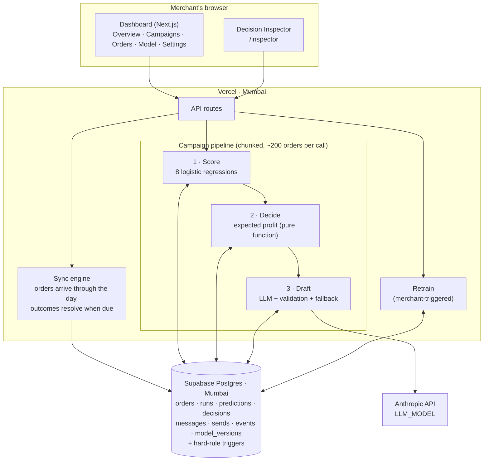

# PayShift · COD-to-Prepaid Decision Engine

**Razorpay AI PM Build Challenge · Track 2: Recover and Grow with AI**
Concept prototype. All data is synthetic; the merchant ("Elvora", Skin · Hair · Wellness) is fictional.

| | |
|---|---|
| 🔗 **Live prototype** | https://cod-prepaid-engine.vercel.app |
| 🤖 **AI build log** | [`docs/AI-BUILD-LOG.md`](docs/AI-BUILD-LOG.md): tools, original prompts, what I rejected, AI vs me, limitations |
| 📄 **Build spec** | [`docs/cod-prepaid-prototype-spec.md`](docs/cod-prepaid-prototype-spec.md): the single source of truth, v1 → v4.9 |

---

## What it does

D2C brands offer cash on delivery (COD), but COD orders cost money: a cash-handling fee and far more returned parcels. Most brands send the same prepaid discount to every COD customer, and much of it goes to people who would have paid online after a plain reminder.

For every COD order from a **repeat customer**, before it ships, PayShift:

1. **Predicts** how the customer would respond to *no message*, a *reminder*, or a *₹50-off offer* (chance of paying online, cancelling, being returned).
2. **Decides** which action earns the merchant the most, using a plain expected-profit sum.
3. **Drafts** the WhatsApp / app-inbox message with an LLM (wording only, never the decision).
4. Lets the merchant **review, untick and approve** before anything is sent.
5. **Measures** extra profit against a random control group that got no message.
6. **Learns**: outcomes from the control and random-test groups retrain the model.

---

## Architecture



### Design choices

| Choice | Why |
|---|---|
| **Score → decide → draft are three separate steps**, each writing its own table | Every number behind a decision is stored and can be shown in the Inspector. The LLM can't influence the action |
| **The decision is arithmetic, not an LLM** | Expected profit for each action from five outcomes (paid online & delivered, paid online & returned, cancelled, COD delivered, COD returned). Pick the highest; if nothing beats "no message", send nothing. Unit-tested against the spec's worked example |
| **Hard rules live in the database** | Triggers refuse to message an order that has paid online, a control-group order, an order past dispatch, or one over the send limit ([`0002_hard_rules.sql`](db/migrations/0002_hard_rules.sql)) |
| **No cron, no Realtime, no Edge Functions** | The sync engine tops up orders and resolves outcomes whenever the Overview is opened. Long work is split into chunked API calls that a tracker in the app keeps calling, so progress and ETA are real and nothing runs unattended |
| **Three groups per campaign** | *Control* (random, no message) measures profit and trains; *random test* (random reminder or offer) trains; *AI-decided* is the result. AI-decided orders are never used for training, so the model doesn't learn from its own choices |
| **LLM guarded on both sides** | Prompt rules (≤300 characters, no false urgency, exact discount only when given, end with the link), then validation in code; failures fall back to a fixed template and are flagged |

### The model

- **8 logistic regressions** trained in TypeScript: paying online × 3 actions, cancelling × 3 actions, return-if-COD, return-if-prepaid.
- Features: past delivered orders, past returns, share of past orders paid in cash, response to past offers, past delivery problem, days since last order, order value, city tier, channel.
- **v1** is trained on a seeded 30-day randomised pilot (~15,000 orders). Retraining uses only control and random-test outcomes. The Model page recommends a retrain after 1,500 new examples.
- The chances of paying online and cancelling are rescaled if they would add up to more than 1, so the five outcome probabilities always sum to 1.

### The data (synthetic)

- **Real dates, Indian time.** The last 30 days are seeded. The **oldest 23 days** have campaigns already sent (fully measured); the **latest 7 days, including today**, are left to run in the demo.
- Today's orders keep arriving through the day (2,000–5,000 a day; ~57% COD; average order ~₹1,074).
- Customer behaviour comes from hidden customer types that the model never sees. **Message wording has no effect on simulated outcomes**, by design.
- Delivery outcomes arrive 3–5 days after dispatch, in real time, so recent campaigns show "Measuring · x% known".

---

## Repository map

```
src/
  app/(dashboard)/      Overview, Campaigns, Orders, Model, Settings pages
  app/inspector/        Decision Inspector (why the AI chose what it did, per order)
  app/api/              API routes: sync, runs (chunked pipeline), messages, model, settings
  lib/core/             Pure logic: decide.ts (expected profit), model.ts (training), llm.ts (prompt + validation), sim.ts
  lib/server/           Database access: pipeline, sync engine, results, seed, model storage
  components/           UI components
db/migrations/          Schema, hard-rule triggers, indexes (apply in order)
tests/                  Unit tests (decision maths, simulation, model, LLM validation)
scripts/                Migration runner; end-to-end integration check
public/payshift-hero.html   Home-page animation (customer gets a nudge → pays on Razorpay checkout)
docs/                   Build spec and AI build log
```

---

## Run it yourself

```bash
cp .env.example .env.local      # fill in the values below
npm install
npm run db:migrate              # applies db/migrations/*.sql
npm run dev
npm test                        # 13 unit tests, incl. the spec's worked example
```

| Variable | What it is |
|---|---|
| `DATABASE_URL` | Supabase Postgres, transaction pooler connection string |
| `ANTHROPIC_API_KEY` | For message drafting only |
| `LLM_MODEL` | Claude model for drafting (default `claude-haiku-5-5`) |
| `SETUP_TOKEN` | Protects the reset page |

Then open `/admin/reset?token=<SETUP_TOKEN>` once to build the 30 days of data (about 3 minutes). The reset page is not linked from the dashboard.

---

## Security and access

- **No secrets in this repository.** All keys are environment variables (local `.env.local` and Vercel project settings); only `.env.example`, with empty values, is committed. The git history has been checked for keys and connection strings.
- The repository is **public and read-only** for everyone except the owner.
- The live demo has no login (single fictional merchant). Reset and re-seed need the private `SETUP_TOKEN`.
