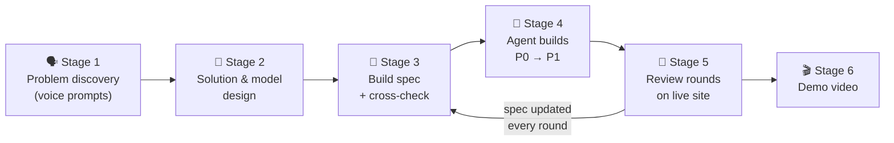
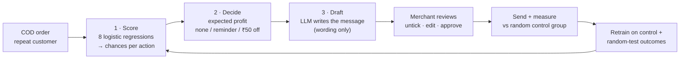
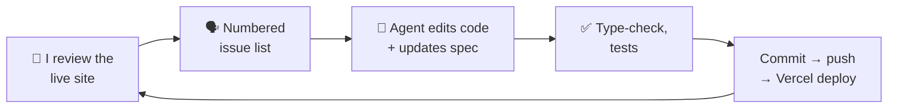

# AI Build Log · PayShift (COD → Prepaid Decision Engine)

**Razorpay AI PM Build Challenge · Track 2: Recover and Grow with AI**

PayShift decides, for each cash-on-delivery (COD) order from a repeat customer, whether to send **nothing**, a **reminder**, or a **₹50-off offer** to get the customer to pay online before the order ships. The merchant approves every campaign, and the extra profit is measured against a random control group. All data is synthetic.

| | |
|---|---|
| 🔗 Live prototype | https://cod-prepaid-engine.vercel.app |
| 💻 Code | https://github.com/SaurVer/cod-prepaid-engine |
| 📄 Build spec (v1 → v4.9, kept in sync with every change) | [`docs/cod-prepaid-prototype-spec.md`](./cod-prepaid-prototype-spec.md) |

### How to read this log

Markdown has no text colour, so each kind of content has a marker. On GitHub the coloured callout boxes render in colour.

| Marker | Meaning |
|---|---|
| 🗣️ | **My original prompt**, quoted exactly as I wrote or spoke it (typos kept; three expletives masked) |
| 🤖 | What the AI produced |
| 🧭 | What I decided |
| ⛔ | AI output I rejected or corrected |
| ✅ | How it was verified |

---

## Contents

1. [At a glance: how AI 10x'd the build](#1-at-a-glance-how-ai-10xd-the-build)
2. [AI tools and models used](#2-ai-tools-and-models-used)
3. [Agent setup and workflow](#3-agent-setup-and-workflow)
4. [The build, stage by stage, with key prompts](#4-the-build-stage-by-stage-with-key-prompts)
   - [Stage 1: Finding the problem (voice prompts)](#stage-1--finding-the-problem-voice-prompts)
   - [Stage 2: Shaping the solution and the model](#stage-2--shaping-the-solution-and-the-model)
   - [Stage 3: Planning the prototype and writing the spec](#stage-3--planning-the-prototype-and-writing-the-spec)
   - [Stage 4: The build](#stage-4--the-build)
   - [Stage 5: Review rounds on the live site](#stage-5--review-rounds-on-the-live-site)
   - [Stage 6: Demo video](#stage-6--demo-video)
5. [AI output I rejected or corrected, and why](#5-ai-output-i-rejected-or-corrected-and-why)
6. [What AI did vs what I decided or built](#6-what-ai-did-vs-what-i-decided-or-built)
7. [Known limitations, risks and verification](#7-known-limitations-risks-and-verification)

---

## 1. At a glance: how AI 10x'd the build

| What I did differently | Effect |
|---|---|
| **Spoke my early prompts** instead of typing them | Thinking out loud about merchants and payers was fast; the AI turned rambling voice notes into structured problem documents |
| **Two models checking each other.** Claude drafted; ChatGPT critically examined Claude's build prompt | After this review, the final build prompt dropped a heavier stack before any code was written |
| **One spec file as the single source of truth** (`v1 → v4.9`) | Every build session started from the same document; every change updated it, so the note, spec and product never contradict each other |
| **An agent with live connectors** (Supabase, Vercel, GitHub) | It wrote code, applied database migrations, pushed, and confirmed each deploy. 27 commits and a working, deployed product in 2 days |
| **Review rounds as numbered issue lists** | I reviewed the live site like a PM and the agent cleared each list in one pass |
| **AI used for the demo video too** | Animation, a script timed to the second against the recording, and narration with a script that fits each line to its slot |

---

## 2. AI tools and models used

| Tool | Model | Used for |
|---|---|---|
| **Claude** (chat and agent) | Claude Opus 5.5 (high effort) | Problem framing, solution docs, build spec, the whole prototype build, debugging, demo-video assets |
| **ChatGPT** | GPT6 sol | Critical review of Claude's build prompt; video ideas and script drafts |
| **Claude Console** (Anthropic API) | Fast, low-cost Claude model set by env var `LLM_MODEL` (default `claude-haiku-5-5`) | **Inside the product:** writes each customer's WhatsApp / app-inbox message |
| *(No LLM)* | 8 logistic regressions, trained in TypeScript | **Inside the product:** predicts the chances of paying online, cancelling and being returned for each action |
| macOS text-to-speech | Built-in macOS voice | Narration for the 90-second video |

> [!NOTE]
> **Two AI layers in the product, on purpose.** The prediction model decides *what* to do; the LLM only decides *how to say it*. The decision itself is plain, unit-tested arithmetic (expected profit per action), so it can be explained order by order.

---

## 3. Agent setup and workflow

**Agent setup**
- Claude working as a coding agent with a shell and Git, **connected to Supabase, Vercel and GitHub**.
- Secrets (database URL, Anthropic API key, model name) live only in environment variables; only `.env.example` is committed.
- Hosting: Vercel (Mumbai region), next to the Supabase Postgres database (Mumbai).

**The loop I ran for every change**

**Standing rules I gave the build agent** (from the build prompt in Stage 4):

> 🗣️ "Use environment variables for all secrets. Never hardcode or commit keys."
> 🗣️ "Never use browser alert/confirm dialogs. All confirmations and authorisation steps happen in the page."
> 🗣️ "Do not use pg_cron, Supabase Edge Functions or Realtime."
> 🗣️ "Keep the three pipeline steps separate (score → decide → draft), each writing its own table"
> 🗣️ "Enforce the hard rules in section 4 in the database, not just the UI."
> 🗣️ "If the spec is ambiguous or something can't be built as written, stop and ask me. Don't guess."

Added later, while building:

> 🗣️ "keep updating the md files as well as the build"
> 🗣️ "You are eating up too much token too fast."
> 🗣️ "Do it in optimal way so that tokens are used less"

---

## 4. The build, stage by stage, with key prompts

### Stage 1 · Finding the problem (voice prompts)

> [!NOTE]
> These prompts were **spoken** and transcribed, so they read like speech. Starting idea: intervene at checkout. Where I landed: act *after* a COD order is placed, for repeat customers only.

**1a. The first instinct: stop COD at checkout**

> 🗣️ "…but I was thinking in a different manner. I was thinking while at the checkout itself, if a user is clicking on COD, how do I make him pick prepaid then and there? And then at this layer later on where COD is already selected, because once COD is selected, the user has clicked uh, to order getting him to prepaid. Even though he's capable of, it's kind of an extra effort on the part of the user. So I want to remove that effort right from the beginning."

**1b. Parking the checkout idea**

> 🗣️ "Uh, what you have suggested makes more sense because ultimately you would need data that you are very confident on. Uh, while intervene intervening at the checkout, it may be a risky move. Uh, both from a information confidence point of view, and it runs a risk of disturbing the users users shopping intent. So okay, let's park that uh, idea for a while. … I have seen uh, some apps sending uh, prepaid messages, for example, without any discounts or anything like that, right? Uh, in Uber, you actually receive when you are midway in the trip, you receive, why don't you pay online? In Tata 1MG also, I have uh, seen similar."

> [!TIP]
> 🧭 **Decision:** no checkout-time intervention. It risks the shopping intent and needs high-confidence data. It went on the "Do not include" list.

**1c. Segmenting merchants and payers**

> 🗣️ "…there are two layers. First, at the checkout itself, where a model determines whether the user is risky or not. … But for the given merchant cohort, that cannot be afforded. Because if that is done, uh, perhaps uh, the merchant starts losing a lot of customers. So he has to uh, uh, offer COD in any case. Now there can be different types of customers for uh, small merchants. First is very new customer. Uh, within that new customer segment, there will be uh, uh, risky customers Uh, non-risky customers, and uh, on the other hand, there are repeat customers as well. Uh, for that brand, within the repeat customer, the chances that they have a good amount of trust and uh, that makes them prefer prepaid is also high."

> 🗣️ "So even though they select COD, they can be converted. So I want to tease these uh, things out and make cases uh, around what happens in what case. And also design the AI layer. … What about brand new customers? Who place us, place COD order and might convert. To a prepaid order midway without even getting a, uh, um, you know, a incentive or with getting an incentive. How does the calculation different? And what are the different levels? Uh, of uh, financial incentive that will convince them. … I need all these uh, uh, scenarios charted out really well…"

**1d. Messages without a discount: where the LLM earns its place**

> 🗣️ "…for the users uh, who essentially wants uh, some kind of in incentive to change their decision. Uh, there can be a model in the backend that will uh, determine the number of discounts, amount of discount, basically. But for those users who does not require incentive are a very frequent uh, prepaid users somewhere else, what kind of different and creative messaging can happen? Based on their spends or uh, uh, something that can you know, improve the trust uh, around the brand for that user. Uh, that can also be included in the messaging, right? And AI can be used. to do that because ultimately it's an LLM."

**1e. Turning the discussion into documents**

> 🗣️ "…draft a new document that will state the problem uh, that we are going to solve different segments uh, under different uh, uh, merchant personas. Right. And then define all the different cases that we are tackling. And what are the different solutions that we are coming up with? What are the levers? That we'll be building how uh, today such a thing is uh, solved or it's not even touched and how will the whole back end calculation … which layer performs the calculation … mind you, I want a crisp document. Uh, without any language gibberish."

> 🗣️ "I mean, i wanted to create another crisp document, where problem, to lever, to solution to workflow is given per merchant persona wise and for each payer type. how the backend mechanism will essentually work in each case, including the status quo today. create a new doc, which is more the solutioning side. include workflow, chart etc if possible"

> [!TIP]
> 🧭 **Decision: MVP scope.** Repeat COD customers of replenishment D2C brands, using the merchant's own data only. First-time customers, social sellers and high-return-risk orders are left out.

---

### Stage 2 · Shaping the solution and the model

> [!NOTE]
> Here I edited my product note with Claude, and kept pushing until the model's maths was complete and every claim in the note was something the model actually does.

**2a. Making the model's role clear**

🗣️ My draft paragraph + instruction (click to expand)

> "How the AI decides
> There are two AI layers in the solution. The first is a predictive ML model that decides what action should be taken. The model uses signals available in the merchant's own data such as past payment mode, successful COD deliveries, RTO history, order value and whether the customer responded to earlier prepaid nudges or discounts. For the MVP, I would focus only on repeat COD customers of replenishment D2C merchants. The reason is that the merchant already has enough first-party data on these customers and hence the model can start making better predictions without depending on cross-merchant data. For new customers, Razorpay's cross-merchant signals can potentially be explored later, subject to privacy and customer consent. The second AI layer is an LLM. Once the predictive model selects the action, the LLM helps frame the message in the merchant's tone and based on the behaviour visible for that customer. For example, a repeat COD customer may only need a simple reminder, while another customer may need more reassurance around delivery. These message variants can also be tested over time to understand which framing works better. In simple terms, the predictive model decides what to do and the LLM helps decide how to communicate it.
>
> In this paragraph, it is not clear how the model provides intelligence. I believe we show make that clear. keeping the word count the same, can you add this if you also think it should be made clear"

**2b–2e. Completing the maths: cancellations, returns, and a probability for every outcome**

> 🗣️ "one thing is troubling me is that we are not adding return cost and chance for each scenario, cancellation to select. shouldnt that be included."

> 🗣️ "show full model at one place clearly"

> 🗣️ "where are the probabiliteies of cancellation. basically for each subsequent events there will be probabilities"

> 🗣️ "I mean for - nothing, nudge, and Rs X off there will different probabilities of delivered , rto, and cancelleation. so the calculations will be more dynamic. thats what i wnat to chart out, what models calculate and what will be the calculation of payoff take of. chart the whole thing properly"

> [!TIP]
> 🧭 **Result:** the expected-profit model in the spec. For each action, five outcomes each get a probability and a payoff:
>
> | Outcome | Probability | Payoff |
> |---|---|---|
> | Pays online, delivered | P(a) × (1 − Rp(a)) | margin − discount |
> | Pays online, returned | P(a) × Rp(a) | − return cost |
> | Cancelled | K(a) | 0 |
> | Stays COD, delivered | (1 − P(a) − K(a)) × (1 − Rc(a)) | margin − cash fee |
> | Stays COD, returned | (1 − P(a) − K(a)) × Rc(a) | − return cost |
>
> **EV(a) = Σ probability × payoff − message cost**. Pick the action with the highest EV; if none beats doing nothing, send nothing.

**2f. Catching a claim the model couldn't back up** (this is the featured correction in Section 5)

> 🗣️ "rom the same screen the merchant can approve, edit or reject a recommendation in one click, set discount caps, exclude customers and pause any play. Live results against the holdout show what each play actually earned. The model can also recommends better configurations, for example lowering the discount cap when a smaller discount is converting just as well, with the expected monthly saving shown.
>
> We are claiming this but right now the models is not providing any intelligence around this. how can this also be handled in the ml model."

**2g–2i. Tightening the note and asking for a real diagram**

> 🗣️ "so fix the language in the above block only where it is required. dont touch sentences where it is not required"

> 🗣️ "do you think a flow diagram or a visualisation of the solution will help. i will add as hyperlink"

> 🗣️ "I was expecting more of a architecture or flow diagram not a verbal diaohrea. hw does the model decide, kicks in etc and s***"

---

### Stage 3 · Planning the prototype and writing the spec

**3a. Asking how to set up the build, before building**

> 🗣️ "after this, i have to build a prototype for the whole solution. The way i want to proceed is to provide you a specification .md file. and ask you to build it. Before that i have few questions
> 1. should i do it in a separate chat so that the context is new or should i use this same context.
> 2. should i generate the .md file based on the chat above or should i start new
> 3. which model should i use to build. first build on lower model and then move to more capable model as the process can be iterative and i want to reduce iterations"

**3b. ⭐ The most important prompt: my product vision for the prototype**

> [!IMPORTANT]
> This is the prompt the whole build grew from. I described the live data flow, the separate model and calculation steps, the debugging site, the dashboard, data hygiene and authorisation. Claude turned it into the build spec.

🗣️ Full prompt (click to expand)

> "The final product in a few lines, plus the MVP scope.
>
> • The synthetic dataset: fields, around 2,000–5,000 repeat-COD customers, and the distributions anchored to your sourced numbers.- The data should be of repeat customer for the target D2C custome. The infrastructure should be like a live data flowing. evry day some 2000-5000 orders coming in automatically. the way i am imagining is that the data will flow in a data base with all the date markers. also the batches are going to be clear separated so that we are have visibility of what batch was already sent. who needs to be sent again even though it was sent once if the merchnant wants to do that. normal flow is to send new set of orders but give floexibility of redoing it. for those who has already been converted, dont sent the prepaid request message ever. so the database should have provisions like this. Not sure if supabase is the right tool . you can suggest.
>
> • The provisional model: what it outputs (conversion, cancellation and RTO chances for each of the three actions).- of course we cannot build the full the working model. what we can do is set up the training loops. The outputs of the model can be provisional but the full data loop needs to be folllwed. when the provisional probabilities are calculated then based on that calculation should be done in another step. and for the purposes of transparency, the final values should be available to be viewable by the merchant for the respective run and order id. this view shuld be the part of the dashboard but not visible directly. there should be another site where you can pull up these information in order to debug or make sense in order to take better decisons
>
> • The exact EV and gain calculation, with every merchant input editable. - the LLm layer sits after the model. a clean integration to the backend and frontend should be implemented.
>
> • The dashboard screens and what each control does. - the dashobard is going to be extensive place to handle operations regarding this whole thing end to end.
>   o The dashboard should be able to show how many orders came and of those how many are cod. The users chooses the cod orders batch to get the recommendations whom to send. Once the notifications are sent, wrt to each sends, a live gain card is visible for with sent , ctr, link opened, changed to preppaid, total estimated gains.
>   o A spearate spreadsheet will show the whole messaging to be sent to the user, among other values such as order value, discount applied if any, editable messageing text., whetjer the message sent on whatsapp or mobile inbox , other important stuff. It is very important to manage the data. which data point is already worked on. what data is going to be used as training . whats part of the hold out and what was used to send messages. I understand CTR data may be diffcult to track. There should be layers or steps that asks for autorisation. this is jsut to show that i know that authorisation is importatn. gains and past run data should also be available to view. The merchant profile and setting page should be there, where data integrations and stuff should be given. the way it happends in a typical data tool. imaginge how a tablewu or statsig would do. The color theme of the dashboard should ideally be of the merchant site there but will signatures of razorpay. Once the user selects the data and tap run to get the output to be sent. there it should be able to show model running and show estimated time. while tahat happens the user can go explore the other areas of the dashboard. when the run completes a notification occurs. more than 1 batch of orders can be run. Therought the dashboard only, you can mangwe the retraining of the model by allowing all the new data you have collected. it should be able to give model accuaratcy. but htese things should be logically spearated not shown direclty on top.
>
> • An explicit "do not include" list, so dropped ideas stay out.
> • What "done" looks like for the 90-second video.
>
> I have added my idea of the app. you can now enrich it and create an md file for me to use in another chat. also tell me which model should i use?"

**3c–3d. Keeping the note honest, and pushing for a complete spec**

> 🗣️ "Agree on all the points,b ut the note is just the proposal note and not exact specification. only thing that we need to make sure is that we are not saying anything on the contratry to what we implement . the check exercise will be done later. for now u[date the md file and tell me which model to use and give me the full prompt to trigger the build."

> 🗣️ "On ehunch i have though, the md file does not seem too extensive, you sure it is all that is required to do. I mean how would you set up supabase without taking my inputs. I mean i cant believe the md file can be this short"

> [!WARNING]
> ⛔ **Rejected: a spec that was too thin to build from.** My push here produced the spec's appendices with *exact values so nothing is guessed*: what I must provide (Supabase project, keys, Vercel), default economics, simulation parameters, roles, the LLM prompt and fallback templates, and model training details.

**3e. Cross-checking Claude with ChatGPT**

> 🗣️ *(to ChatGPT)* "for the purpose of building the dashboard prototype heres what claude is proposing the md file should be. critically examine"

🤖 Claude's draft build prompt that I sent for review (click to expand)

> "…Stack: Supabase (Postgres, pg_cron, Realtime, Edge Functions), Next.js App Router with TypeScript and Tailwind, TanStack Table, Recharts, Anthropic API for message drafting, deployed on Vercel, as described in section 2 of the spec. If Supabase setup blocks progress, use the SQLite fallback described there and tell me."

> [!WARNING]
> ⛔ **Changed after the review:** the draft relied on **pg_cron, Realtime and Edge Functions**. The final build prompt forbids all three. The "live" order flow runs on a simple server-side clock that catches up on each page load, plus chunked API calls. That means fewer moving parts, nothing running in the background that could break during a demo, and it fits Vercel.

---

### Stage 4 · The build

**4a. The build trigger prompt** (sent with the spec attached)

🗣️ Full prompt

> "You are building a working prototype for my Razorpay AI PM Build Challenge submission (Track 2: Recover and Grow with AI). The full specification is in the attached file cod-prepaid-prototype-spec.md. Treat it as the single source of truth.
>
> **Context**
> • Deadline: 13 Oct 2026, 11:59 PM IST. I need a working, demo-ready prototype, not a production system.
> • It will be shown in a 90-second video. Section 12 of the spec ("Done" for the video) is the acceptance test.
> • All data is synthetic. Every screen must carry a "Concept prototype · synthetic data" label.
>
> **Rules**
> • Follow the spec exactly. Do not add features, metrics or concepts that are not in it, and never add anything from section 10 ("Do not include").
> • If the spec is ambiguous or something can't be built as written, stop and ask me. Don't guess.
> • Keep the three pipeline steps separate (score → decide → draft), each writing its own table, exactly as in section 5. The decide step must be a pure, unit-tested function that passes the worked example in section 11.
> • Enforce the hard rules in section 4 in the database, not just the UI.
> • Use environment variables for all secrets. Never hardcode or commit keys.
> • Never use browser alert/confirm dialogs. All confirmations and authorisation steps happen in the page.
> • Do not use pg_cron, Supabase Edge Functions or Realtime. Use the lazy-tick sim clock and chunked API processing described in section 2.
>
> **How to work**
> 1. Read the whole spec. Then reply with: (a) your build plan in about 10 lines, (b) any ambiguities or decisions you need from me, (c) exactly which credentials and setup steps you need from me (Appendix A). Do not write code until I confirm.
> 2. After I confirm, build P0 end to end (section 13) before starting P1.
> 3. After P0, stop and give me: the local run command, the deployed Vercel URL, and a short click-through checklist to verify each P0 item. Tell me plainly what works, what is simulated, and anything you skipped or changed and why. Wait for my go-ahead.
> 4. Then build P1, then P2, with the same checkpoint after each.
> 5. Finish with a README covering setup, reset-demo steps, and the exact click path for the 90-second video.
>
> Start with step 1 now."

**4b. What the build spec locked in** (excerpt from the spec, section 1)

> 🤖 "The part to protect at all costs: **live order flow → real model → real EV calculation → real LLM draft → merchant approval → simulated outcome → randomised holdout → measured incremental ₹ → Inspector explanation → retraining.**"

> 🤖 *(the in-product LLM prompt, spec Appendix E)* "You write short prepaid-conversion messages for {merchant_name}, a D2C wellness brand. Tone: {tone_guide}. The customer already placed a cash-on-delivery order. Your message invites them to pay online now with a one-tap link. Rules: max 300 characters; no false urgency or countdowns; no pressure; mention the discount only if one is given, with its exact amount; never mention data about the customer beyond what is provided; end with the placeholder {link}. Return JSON only…"

✅ Every LLM draft is validated in code (length, the link, no discount mentioned in a plain reminder). If a draft fails, a fixed template is used and the order is flagged as a fallback.

---

### Stage 5 · Review rounds on the live site

> [!NOTE]
> After each deploy I used the product as a merchant would, wrote a numbered list of everything that was wrong or confusing, and the agent fixed the list, updated the spec and redeployed. The spec went from **v1 to v4.9**.

#### Round 1: "the first page is boring" → spec v2

🗣️ Full prompt (10 issues)

> "few problems with the dashboard
> 1. The first page is boring-
>    1. the color scheme needs to match the razor pay website- here is the website- https://razorpay.com/
>    2. the first page shows results of one day at a time but. the page should include date pills with filtsers at the start. clicking on the pills to see what happened on that day.
>    3. Mony at stake bucket has a calculation but not very clear. the judge will not understand
>    4. what the f*** is sim time. i understand that we need multiple days but i dont want future days to come. can you seed data for last 30 days assuming i will not run the last date. also give me power reset the whole dashboard again. its a prototype afterall
>    5. NO one undersatnds Pause , advance days
>    6. The font selection and card sizing is vey unprofessional
>    7. from the first page, other pages does not seem connected. user has to click on on sidebar to reach othe side. ideally, there should be way to see all the orders from the all orders card, cod orders etc. this should be inplemented such that user can come back easily.
> 2. Data and model is blank
>    1. I was expecting the model outputs will be added for each day run there for diagnostics but its not there. why? it should be there given we have supabase and whole data backend
> 3. the pages are not well connected. run reviews is sending to the first bage , but the journey feels broken. no one understands Run #1.
> 4. bunch of random s*** is wriiten. no one will understand what is model group and s***
> 5. the model was supposed to send to customers but ultimately orders are covered. why are you writing custome count in nudge, no action
> 6. why can runs also be covered in the first page. first page will have data for each date,s a click expands for that date and run can be triggered from there. extra details can be viewed by clicking see more.
> 7. approve and send flow is broken. it should be one click to approve and send, then a pop up comes with the summary. and the user confirms. right now it show reject selected and s***. i understand we are not actually sending. but we can fake it. to undersatand the result we will be tracking with the updated orders database to understand what happened to the order, changed or not. right now things are stuck at the send.
> 8. one more thing that i am seeing is that the orders are adding for future dates automatically. that is wrong. i undersatnd for current date the orders can come gradually, we can have refresh button to load the data and refresh the dashboard. but dont add future dates. just populate last 30days and make provision of adding orders ncerementaly for each day. for example today is 11 oct , so data for oct should keeping coming in the backend but will appear only when i reload. if i pass the mdnoght the databae should collect data for next date.
> 9. I need a master refresh switch outside the app so that i can refresh everything after testing. dont include in the app.
> 10. Cahnge the merchant name to some coll wellness and beatuty brand. create its own logo to show on top. but show razor pay logo and keep razorpay theme.
>
> based on these inputs you need to do 2 things. Update the md file and make modifications go"

| ⛔ What I rejected | 🧭 What it became |
|---|---|
| A simulated clock with **Pause / Advance day** and future dates appearing | Real calendar dates: the last 30 days seeded, today's orders arriving through the day, a new date after midnight |
| Internal words: "Run #1", "model group", "customer count" | Plain names: "Campaign · 10 Oct, 9:00 PM", "AI-decided", counts of *orders* |
| A broken approve flow with "reject selected" | One click "Approve & send" → summary pop-up → confirm |
| A reset control inside the app | A token-protected reset page outside the app's navigation |

#### Round 2: "what does extra earning with respect to control mean" → spec v3

🗣️ Full prompt (15 issues)

> "couple of issues still remain
> First of all the tabs are slow to load. when i click on different dates, the load happens late.
> 2. I was expecting the previous dates to be not filled. i was planning to run them in the demo and testing phase
> 3. What does extra earning with respect to control mean. its not clear how you are. comparing
> 4. see more about 11 oct is not working when the run is happening. then why is it there?
> 5. Review and send is happening in the same overview window
> 6. random test and control is correct but it is not clear, what they will be used for. we can say they are used to compare the performance and also to feed while training. this needs to be crisp communication
> 7. While running the model, it runs in the same overview window, which is good. but there should be dedicated run windows too where all the old runs are also available
> 8. give provision to select control percentage as well as random rtest percentage. the user may want to not have random test because he may be very confident of the model.
> 9. also as we are collectiong data for training with each run. show separately at some place how much training data is available to be used. A separate model window page should model. a proper way to show the model paramenters. how the training data looks like and what are the outputs of for each run. I mean each run will give outputs which is used to do the final calculation. right now all that information is not available. I want that information.
> 10. refresh on top should not be present on all the pages.
> 11. when on model page i click on date, i go to overview page summary. i want more detailed view as pointed in 10.
> 12. In the preview page the expanded cards and other dates are similarly colored. cant differentiate the expanded view vs closed
> 13. Dewlune is a bad name, change it
> 14. There has to be hero mast on the main page describing the tool. an appropriate name would help. a suitable name and design on the top
> 15. Date ranges should also be shown with a filter too.
>
> need to fix all of these. do it. update the .md file update the site too"

🧭 **Decided here:** the merchant chooses the control % and random-test % per campaign; a "Groups explainer" says what each group is *for* (control = measure + train, random test = train, AI-decided = result); a dedicated Campaigns page; the brand renamed **Elvora** and the product named **PayShift**.

#### Round 3: "the model page is extremely confusing" → spec v4

🗣️ Full prompt

> "issues remaining
> The model page is extremely confusing
> it is not very clear what the top cards are meant to communicate
> NO one will understand control and random test card and not even pilot. what would a merchant understand from them
> even the top cards dont mean much. training data available 0 control 0 random test- w*f, what is new since last training
> parameters and accuracy tabs are not very useful to merchant.
> w*f is summary
> in model what i wanted to see is that
> 1 how many new training samples have been collected and a recommendation to retrain the model again
> 2. for each run of the model to generate results, for each order what was the probabilites calculated. the column name should be intuitive
> while running campaign, dont automatically send me to campaign page. i was redirected to campaign page but when i cam back to the overview page, the latest date was opened. ideally the state should be preserved, the opened date should be visible open
> consider the screenshot, it is okay but not amazing layout of the dates. i was expecting a filter also for past days as old and old dates are availabel
> the hero mast is bad. no real tool would explain that in a that manner
> model output redirect is great
> revisit full order inspector page as some cards seems overlapping
> the calculations are not very intutive even though. need to explain to a layman.
> is it wise to open Decision Inspector in a separate tab. your call
> after sending the campaign another card opens(screenshot)
> chart is not very clear. a layman user needs to understand
> dont need to expand the latest date automatically when i land on overview page.
> update the md file and make the changes"

🧭 **Decided here:** the Model page answers exactly two questions: *is it time to retrain?* (new learning examples vs a 1,500 threshold) and *what did the model predict for every order?* Technical tabs moved to a separate page. Calculations are shown as "Out of 100 orders like this one…".

#### Rounds 4+: one thing at a time

| 🗣️ My prompt (verbatim) | 🧭 What changed |
|---|---|
| "lets take one thing at a time now. this view is worse thatn before. what i meant was to provide filter select from a drop down. Not this expanded view. keep updating the md files as well as the build" | ⛔ The AI's calendar grid was rejected and replaced by three dropdown filters: period, campaign status, go to a day |
| "this explanation does not work. imagine a layman is reading. it will not make sense at all." | ⛔ Explainer rewritten with a medicine-trial analogy and three plain steps |
| "the Extra profit vs control is not getting updated. Also, it's not clear whether the calculation assumes average or what. show better calculation for layman." | A "so far" estimate while measuring; the explainer rewritten in **totals**, not averages |
| "One more thing … while approve and send, provide functionality to select deselct individual orderrs as well as select deselect orders that are in random test or ai - decided. Provide a clean way,. not messy. in the campaign order details, right now order date is not mentioned. do it with min use of token." | A Send checkbox per order, plus two group toggles; an "Ordered" date column |
| "one more thing, right now we have 30 days of period, what i want now is to run the 23 days and leave the latest 7 days for me to run for demo. also right now the profit is negative , which is a fatal situation. the whole idea is to show profit. Do it in optimal way so that tokens are used less" | Campaigns seeded on the oldest 23 days, 7 days left for the demo; the negative figure traced to a **biased estimator** (see Section 5) |
| "even though we are running old days, but we dont need to mention replay in dashboard. remove that and deep data runs so far stay. dont delete them. in the screenshot, orders page does not have date filter. Do it in optimal way so that tokens are used less" | No mention of past-day mechanics on screen; From/To date filter on Orders |
| "two last things / the site is very slow, cn you make it fast / when i run for old days, a yellow banner shows replay. dont show that. i want a feel of production." | A covering database index, a rewritten daily query (≈0.5 s → 0.2 s), parallel queries |
| "there is a small bug, when i satrt campaign run, the run shows on the top , but does not show on the card, only when i click again it satrarts showing" | The day card now reads the live list of running campaigns |
| "for the old days run, the measuring percentage does not seem to increase gradually. i am supposing they should increase gradually." | ✅ Checked against the live database: no bug. Deliveries arrive 2–4 days after dispatch, on schedule |

---

### Stage 6 · Demo video

**6a. Home-page animation: a customer's journey with no captions**

> 🗣️ "I have an idea for the first page hero banner … animation where an eligible cod user receives nudge message … clicks there and performs the payment … in a clean manner."

> 🗣️ "the video is poorly built. i want to show the steps but not include text to show steps. also the checkout page should be razorpay checkout at the end. recreate the video."

> 🗣️ "The messages inside the whatssapp looks so unrealistic and fudgeg can you create a right sequence of message that conveys that request is to move to prepaid"

> 🗣️ "message 2 has to be convincing message. thats the whole concept."

> 🗣️ "the payment page still doesnt indicate the payment gateway is of razpr pay. can you look on how it atually looks on internet"

> [!WARNING]
> ⛔ **Rejected three times:** captions on each step, unrealistic chat messages, and a generic payment page. ✅ The final checkout was rebuilt against the layout of Razorpay's live demo checkout page, then embedded in the home page:
>
> 🗣️ "This is fine now. can you embed this in the hero banner. … add real razor pay logo and name of the tool in one side and on other side this html … it does not occupy space uselessly."

**6b. Script and narration timed to the screen recording**

> 🗣️ "i have the walkthrough of the video 90 seconds. if i upload the video, would you be able to add audio based on the screen that is shown?"

> 🗣️ "the script is not landing properly. misplacements around what is being shown and spoken. can you carefully adjust that. a faster narration is ok."

🤖 The recording was cut into frames at every screen change, and the script was split into 15 lines, each starting at the exact second its screen appears. A Terminal script then generates each line with macOS text-to-speech and speeds it up until it fits its slot.

---

## 5. AI output I rejected or corrected, and why

### ⭐ Featured: the product note promised intelligence the model didn't have

> [!WARNING]
> **🤖 What the AI wrote** (in the product note we drafted together):
> "The model can also recommends better configurations, for example lowering the discount cap when a smaller discount is converting just as well, with the expected monthly saving shown."
>
> **🗣️ What I said:**
> "We are claiming this but right now the models is not providing any intelligence around this. how can this also be handled in the ml model."

**Why I corrected it**
- It sounded impressive, but nothing in the model produced it. The model predicts outcomes for each order; recommending settings is a different problem, needing experiments on the settings themselves.
- A judge reading the note and then opening the prototype would find the claim unsupported, and every other claim would lose credibility with it.
- I set a rule for the rest of the build: *"we are not saying anything on the contratry to what we implement."*

**What changed**
- The claim was removed from what the model does. "The model recommending configuration changes" went onto the spec's **Do not include** list, with only a "coming later" mention.
- The merchant keeps those levers directly: discount amount, control % and random-test %, and unticking orders before sending.

### More corrections

| # | ⛔ AI output | Why I rejected it | 🧭 Fix |
|---|---|---|---|
| 1 | **"Extra profit so far" showed −₹58,547** on recent campaigns | Cancellations are known the next day; deliveries take 3–5 days. Early numbers were mostly ₹0 cancellations, so the average was biased low. The arithmetic was right; the sample was wrong | Profit per *shipped* order, scaled by the share not cancelled; shown only once half of each group is known; otherwise "Measuring · x% known" |
| 2 | Build prompt with **pg_cron, Realtime, Edge Functions** | More moving parts than a demo needs; background jobs that could fail on camera | Banned; a clock that catches up on each page load, plus chunked API calls |
| 3 | A **thin spec** | "how would you set up supabase without taking my inputs" | Appendices with exact values, so nothing is guessed |
| 4 | **Simulated clock** with Pause / Advance day | No merchant understands "sim time" | Real dates; orders arrive through the day |
| 5 | **Calendar grid** of days | Harder to scan than before | Three dropdown filters |
| 6 | **Analyst language** ("EV", "uplift", "holdout") | Merchants and judges couldn't follow it | "Out of 100 orders like this one…", totals-based sums |
| 7 | **Generic checkout** in the animation | Didn't look like Razorpay | Rebuilt from the live Razorpay checkout layout |

---

## 6. What AI did vs what I decided or built

| 🧭 I decided / built | 🤖 AI did |
|---|---|
| **The problem:** COD costs merchants money, and blanket discounts are wasted on customers who'd pay online with a plain reminder | Turned my voice notes into structured problem and solution documents |
| **The scope:** repeat COD customers only; no checkout intervention; no first-time customers, social sellers or high-return-risk orders | Wrote the build spec from my vision prompt, then kept it in sync (v1 → v4.9) |
| **The three actions** and that the choice is an **expected-profit calculation**, not an LLM | Implemented the expected-profit function and its unit tests from the worked example |
| **The full outcome model:** a probability for paying online, cancelling and being returned under each action | Built the 8 logistic regressions, training, and the per-order predictions view |
| **The proof design:** a random control group to measure, a separate random-test group to train, AI-decided orders never used for training | Built the simulation, the 30-day seeded history and the live order flow |
| **Merchant control:** nothing sent without review; untick orders or whole groups; group sizes set per campaign | Built the campaign window, the checkboxes and the confirm pop-up |
| **The LLM's limits:** wording only, never the action or discount, validated before sending | Wrote the drafting step, validation and template fallback |
| **The language standard:** if a merchant can't follow it, it's wrong | Rewrote copy and explainers each time I rejected them |
| **The data rules:** never message a converted order; batches clearly separated by date | Enforced them in the database with tests |
| **Every review round**, what to reject, and the cross-check with ChatGPT | Applied the fixes, sped up queries, fixed bugs, deployed every change |
| **The demo story** and the recording | Built the animation, timed the script to the recording, generated the narration |

---

## 7. Known limitations, risks and verification

### Limitations

| | |
|---|---|
| 🧪 **Synthetic data** | Customer behaviour comes from a simulation with hidden customer types. The numbers show that the *method* works, not what a real merchant would earn |
| ✍️ **Wording has no effect** | By design, message wording doesn't change simulated outcomes, so the LLM can't inflate results. It also means the prototype can't test which wording works best |
| 📉 **Simple model** | Logistic regressions on a handful of features: enough to rank three actions, not tuned for accuracy |
| ⏳ **Results take days** | Delivery outcomes arrive 3–5 days after dispatch, as in reality, so recent campaigns show "Measuring" |
| 🎲 **Small samples are noisy** | With a 10% control group, a single day can show a loss even when the method works over many days, and some seeded days do |
| 👤 **One merchant, no login** | No authentication or multi-merchant separation |

### Risks if this went live

> [!CAUTION]
> - **Customers learning to wait for a discount.** If customers learn that COD brings a ₹50 offer, more may pick COD on purpose. Offers go only to repeat customers and only where the model expects them to pay off, and the control group would show it as falling extra profit.
> - **Message fatigue and consent.** Real sending needs WhatsApp template approval, opt-in records and frequency caps.
> - **Over-trusting the model.** The merchant sees every decision and its sum, can exclude orders, and decides when to retrain. The model never changes its own settings.
> - **LLM wording.** The LLM writes text only, and every draft is checked against fixed rules (length, link, no discount in a reminder, no customer data beyond what was given). It cannot change the action, the amount or who receives a message.

### Verification

| ✅ Check | How |
|---|---|
| Decision maths | Unit tests reproduce the spec's worked example (EV ₹257.50 / ₹285.13 / ₹260.70 → choose the reminder). `npm test`: **13 of 13 pass** |
| Hard rules | The database rejects any send to an order that already paid online (tested). Control-group and past-dispatch orders are blocked at the database level |
| Every number traces back | The Decision Inspector shows, for any order: what the model knew, the predicted chances, the sum for each action, and why one won |
| Live data | SQL checks against the live database, e.g. confirming "Measuring · 11% known" was rising on schedule rather than stuck |
| Claims vs product | The product note was checked against what's built; anything not built went to "Do not include" |
| Every deploy | Reviewed screen by screen on the live site before the next round |
